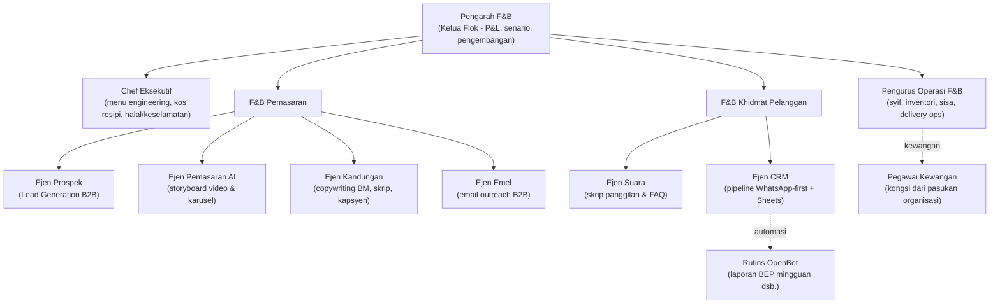

# FNB-PLAYBOOK.md — Pasukan Bot Perniagaan F&B Malaysia

> Dokumen induk flok F&B. Berasaskan deep research November 2025 (DOSM, MySST/RMCD,
> halal.gov.my, Banci Ekonomi 2022) — pemisahan tegas antara **[DISAHKAN]** (angka dari
> sumber rasmi yang berjaya diakses) dan **[ANGGARAN]** (amalan industri, perlu semakan).
> Laporan research penuh tersimpan di `/tmp/fnb_malaysia_research.md`.

---

## 1. Landskap Pasaran [DISAHKAN — DOSM/MySST]

| Angka | Nilai |
|---|---|
| Hasil perkhidmatan F&B | RM75.2B (2024) → **RM83.0B (2025, +10.4%)**; Q1/Q2 2026: RM22.1B/RM22.4B per suku |
| Pertubuhan | **136,453** (Banci Ekonomi 2022); 88.3% milikan perseorangan (purata output RM420k), Sdn Bhd 8% tapi 44% output (purata RM4.0M) |
| Pekerja | 858,131 (2025); hasil +15% vs 2019 tapi pekerja masih < 2019 — **automasi = tema produktiviti** |
| Gaji median sektor | RM2,013/bln (2025); gaji minimum RM1,700 [ANGGARAN semakan] |
| Selangor | 40% output negara (RM39.9B) — geo-prioriti |
| Inflasi makanan-luar-rumah | +6.7% ('23), +3.6% ('24), +4.0% ('25), +2.6% (Sep '26) — sentiasa atas inflasi umum |
| Pembayaran digital | RM13B → RM240B/bulan (2019→2026, BNM); ATM -35% — QR/e-wallet wajib |
| Katering & acara | RM6.7B, 16,208 pertubuhan — bukan ceruk kecil |

**Peraturan kunci [DISAHKAN]:**
- **SST perkhidmatan F&B = 6% (BUKAN 8%)**, ambang RM1,500,000/12 bulan, efektif 1 Mac 2024 (kod 9902.01.2651) — dakwaan umum "SST F&B 8%" adalah SALAH (disemak terus dari MySST FAQ rasmi)
- **Sewa/leasing = 8%** ambang RM500k, 1 Jul 2025 — beban sewa naik bila tuan premis berdaftar
- Halal JAKIM: sijil dalam 30 hari selepas prosedur lengkap, sah 2 tahun, via MYeHALAL
- Akta Makanan 1983 + kursus pengendalian makanan (sah 5 tahun) + vaksin antitifoid

## 2. Enam Senario Perniagaan (semua modal/margin [ANGGARAN])

| Senario | Modal | Kakitangan | Margin kasar | Risiko #1 | Kesesuaian bot |
|---|---|---|---|---|---|
| **Kopitiam/Mamak 24 jam** | RM150k-400k | 8-15 (2-3 syif) | 35-45% | Kos tenaga 24 jam | TINGGI |
| **Kafe khas / kopi rantai** | RM300k-800k | 5-10 | 55-70% (kopi) | Tepu bandar + sewa | TINGGI |
| **Dapur awan / jenama maya** | RM50k-150k | 3-6 | 50-60% pra-komisen | Komisen 25-35% + ranking | SANGAT TINGGI |
| **Restoran keluarga/steamboat** | RM200k-500k | 8-12 | 45-55% | Sisa bahan basah + musiman | TINGGI |
| **Katering & acara (B2B)** | RM30k-100k | 5-10 + krew | 35-50% | Aliran tunai deposit | SANGAT TINGGI |
| **Food truck / bazar Ramadhan** | RM5k-80k | 2-5 | 55-65% | Permit/lot + cuaca | TINGGI |

Data penuh setiap senario (saluran, KPI, nota) dari alat `scenari_fnb` — sumber kebenaran
pasukan dalam perbualan.

## 3. Carta Organisasi Flok F&B (9 Bot)

| Bot | Fungsi teras | Alat `malaysia/*` yang wajib dipakai |
|---|---|---|
| `pengarah-fnb` | Nilai idea, banding senario, P&L, ujian BEP wajib | scenari_fnb, kira_bep |
| `chef-eksekutif` | Menu engineering (bintang/ploughhorse/puzzle/fish), kos resipi, halal | kalkulator_harga_jual, scenari_fnb |
| `pengurus-operasi-fnb` | Syif, sisa <3%, margin selepas komisen delivery | kira_bep, kalendar_cuti, templat_minit_mesyuarat |
| `ejen-prospek` | ICP, senarai sasaran, siri susulan 1/3/7/14 | scenari_fnb, kalkulator_harga_jual |
| `ejen-pemasaran-ai` | Storyboard 15-30s, karusel IG, prompt AI imej/video | pelan_kandungan_fnb, scenari_fnb |
| `ejen-kandungan` | Kapsyen, skrip, keterangan menu, broadcast WhatsApp | pelan_kandungan_fnb, analisis_teks_bm, jawab_ulasan |
| `ejen-emel` | Draf emel B2B + siri susulan + pematuhan PDPA | kalkulator_harga_jual, glosari_kerajaan |
| `ejen-suara` | Skrip panggilan, FAQ, bantahan, roleplay latihan krew | jawab_ulasan, analisis_teks_bm |
| `ejen-crm` | Pipeline 6 peringkat, templet Sheets, SOP susulan, rutin | scenari_fnb, kira_bep |

## 4. Batas Keupayaan — Jujur Dari Hujung Ke Hujung

| Ejen | Boleh DALAM deployment ini | Perlukan penyepadatan luar |
|---|---|---|
| Ejen Prospek | Senarai sasaran, ICP, draf susulan, sebut harga | Scraping prospek bebas; WhatsApp API |
| Ejen Pemasaran AI | Storyboard, karusel, **prompt** AI, brief | Penjanaan video/imej sebenar (guna prompt ke alat AI luar) |
| Ejen Kandungan | Semua teks: kapsyen, skrip, menu copy | Auto-post media sosial |
| Ejen Emel | Draf + jadual + siri susulan (status: DRAF) | SMTP/penyedia emel untuk HANTAR |
| Ejen Suara | Skrip, FAQ, roleplay, analisis transkrip | Telefoni (Twilio dsb.) untuk panggilan sebenar |
| Ejen CRM | Reka bentuk pipeline, templet Sheets, SOP, rutin OpenBot | API CRM/POS/Sheets live |

Prinsip dari research: **88% pemilik = enterprise perseorangan** — bot MELAPOR & MENYEDIA,
manusia memutuskan. Setiap prompt ejen ada blok "KEPAYAAN JUJUR" supaya tiada dakwaan palsu.

## 5. Kemahiran F&B (5 baharu) & Alat (18 jumlah)

Kemahiran: `scenari-fnb`, `kos-menu-fnb`, `kempen-fnb`, `prospek-fnb`, `balasan-ulasan`
(sumber kebenaran: `skills.yaml`; geran auto-seed oleh sync tenant).

Alat F&B baharu di pelayan MCP `malaysia` (semuanya baca sahaja, data tanam dari research):

| Alat | Input | Output |
|---|---|---|
| `scenari_fnb` | senario?, aspek? | 6 senario penuh + data pasaran DOSM + peraturan SST/halal |
| `kalkulator_harga_jual` | kos_bahan, harga_sedia_ada?, food_cost_target? | harga jual + food-cost % + nota SST 6% |
| `kira_bep` | kos_tetap_bulanan, purata_harga_pesanan, kos_pembolehubah%? | BEP RM/pesanan/harian + zon bahaya <1.1x |
| `pelan_kandungan_fnb` | jenama, senario?, tema_musim? | kalendar 7 hari mengikut funnel tempatan |
| `jawab_ulasan` | ulasan, penilaian?, jenama?, konteks? | balasan BM+EN, positif/negatif, garis merah |

**Geran:** 21 Bot × 18 alat = **378 geran `mcp`** (bootstrap idempoten).

## 6. Saluran Jabatan (9 jumlah)

Baharu: `fnb-eksekutif` (Pengarah/Chef/Operasi/Kewangan), `fnb-pemasaran` (4 ejen + Pegawai
Pemasaran), `fnb-khidmat-pelanggan` (Suara/CRM/Pembantu). Yang lama kekal.

## 7. Rutin yang Dicadangkan (guna ciri Routines OpenBot)

1. **Mingguan (Isnin 9am):** Pengarah F&B + `kira_bep` — laporan BEP mingguan
2. **Mingguan (Jumaat):** Ejen Kandungan + `pelan_kandungan_fnb` — kalendar minggu depan
3. **Bulanan:** Penasihat Pematuhan — semak kalendar SST-02, halal (2 tahun), lesen PBT
4. **Bulanan:** Chef Eksekutif — semak semula harga menu ikut CPI makanan-luar-rumah

## 8. Yang Belum Disahkan (jujur — semak manual sebelum guna)

- Komisen delivery 25-35% [ANGGARAN] — tiada angka rasmi di muka merchant; SDK rasmi Grab
  Food wujud (GitHub DISAHKAN) untuk integrasi sah
- Yuran halal/SSM tepat; gaji minimum fasa <5 pekerja; kadar EPF/SOCSO terkini
- PriceCatcher harian (harga makanan DOSM) — 404 semasa research; semak semula
  pricecatcher.gov.my
- Julat modal semua senario — sahkan dengan operator sebenar/temuduga

## 9. Cara Guna (contoh pertanyaan pembuka)

- Pengarah F&B: *"Aku ada RM200k, nak buat business. Senario mana paling sesuai? Jalankan BEP."*
- Chef Eksekutif: *"Kira kos nasi goreng ayam: bahan RM4.20/hidangan. Berapa harga jual?"*
- Ejen Prospek: *"Nak prospek katering korporat di Shah Alam. Buat ICP + siri susulan."*
- Ejen Pemasaran AI: *"Buat storyboard TikTok 20 saat untuk bazar Ramadhan kami."*
- Ejen Emel: *"Draf emel susulan sebut harga hari ke-3 untuk penganjur konvension."*
- Ejen Suara: *"Skrip panggilan semak kehadiran acara + roleplay pelanggan marah."*
- Ejen CRM: *"Reka bentuk CRM Sheets untuk kafe aku + SOP susulan prospek."*
