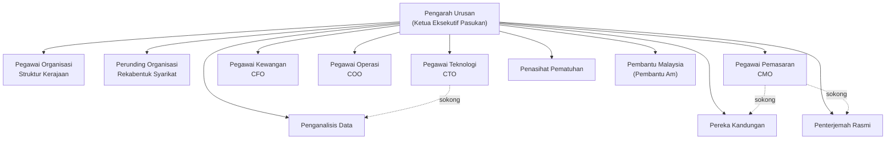

# WAR-ROOM.md — OpenBot Malaysia Sedia Berperang

> Dokumen induk upgrade "Bilik Perang". Hasil research (GitHub API + Hacker News/Reddit
> komuniti, November 2025) dilaksanakan terus ke dalam deployment ini: 12 Bot membentuk
> carta organisasi Malaysia, 10 kemahiran, 6 saluran jabatan, dan pelayan MCP tempatan
> dengan 13 alat disahkan — semuanya berjalan dan bergeran sepenuhnya.

> **LAMBAKAN F&B (November 2025):** 9 Bot F&B baharu (Pengarah F&B, Chef Eksekutif,
> Pengurus Operasi, + 6 Ejen: Prospek, Pemasaran AI, Kandungan, Emel, Suara, CRM), 5
> kemahiran F&B, 5 alat F&B baharu (jumlah 18 alat) dan 6 saluran (jumlah 9) — berdasarkan
> deep research DOSM/MySST. Dokumen induk F&B: **FNB-PLAYBOOK.md**. Roster kini 21 Bot,
> geran 378.

---

## 1. Carta Organisasi Pasukan (12 Bot)

OpenBot tidak mempunyai konsep induk-anak ejen (keputusan arkitek mereka: ejen bebas,
kerja dihos melalui saluran dan handoff) — jadi carta organisasi ini hidup di tiga tempat:
gelaran Bot, saluran jabatan, dan dokumen ini.



| # | Bot (id) | Gelaran | Kepakaran | Kemahiran |
|---|---|---|---|---|
| 1 | `pengarah-urusan` | Pengarah Urusan | Taklimat strategik, laporan eksekutif, keputusan lintas jabatan | bilik-perang, ringkasan-mesyuarat, lukis-carta |
| 2 | `pegawai-organisasi` | Pegawai Organisasi | Struktur kerajaan persekutuan/negeri, kementerian, GLC | carta-organisasi, data-malaysia, lukis-carta |
| 3 | `perunding-organisasi` | Perunding Organisasi | Carta organisasi syarikat: Sdn Bhd, Berhad, GLC, SME, koperasi | carta-organisasi, lukis-carta |
| 4 | `pegawai-teknologi` | CTO | Seni bina sistem, integrasi API/MCP, rajah teknikal | lukis-carta, analisis-data, bilik-perang |
| 5 | `pegawai-kewangan` | CFO | Bajet, anggaran kos, format RM, struktur laporan kewangan | analisis-data, ringkasan-mesyuarat |
| 6 | `pegawai-operasi` | COO | SOP, aliran kerja, minit mesyuarat, perancangan acara | ringkasan-mesyuarat, hari-kelepasan, lukis-carta |
| 7 | `pegawai-pemasaran` | CMO | Kempen BM, analisis pasaran, kalender kandungan | bilik-perang, analisis-data, terjemah-rasmi |
| 8 | `penganalisis-data` | Penganalisis Data | Set data terbuka data.gov.my, statistik, anti-reka-angka | analisis-data, data-malaysia, lukis-carta |
| 9 | `pereka-kandungan` | Pereka Kandungan | Penulisan BM korporat, komunikasi rasmi | terjemah-rasmi, ringkasan-mesyuarat |
| 10 | `penterjemah-rasmi` | Penterjemah Rasmi | Terjemahan BM <-> EN istilah rasmi terkunci | terjemah-rasmi |
| 11 | `penasihat-pematuhan` | Penasihat Pematuhan | Akta Syarikat 2016, PDPA 2010, Bursa, tata kelola | carta-organisasi, ringkasan-mesyuarat |
| 12 | `pembantu-malaysia` | Pembantu Malaysia | Kerja harian dalam BM, penciptaan Bot/kemahiran | bot-creator, skill-creator, data-malaysia, ringkasan-mesyuarat, hari-kelepasan |

## 2. Kemahiran (10) dan Kit Perang

4 kemahiran asal + 6 kemahiran Bilik Perang baharu. Sumber kebenaran:
`examples/malaysia/skills.yaml` (pakej OpenBot — kemahiran adalah *pengetatan*, bukan
geran; geran ada di `plugin_grants`). Setiap kemahiran baharu ada padanan format
**standard terbuka SKILL.md** (agentskills.io) di `war-pack/skills/<slug>/SKILL.md`
untuk import ke mana-mana ejen patuh standard.

| Slug | Alat pelayan `malaysia` yang dirujuk |
|---|---|
| `carta-organisasi` | carta_organisasi_persekutuan, senarai_kementerian, senarai_negeri, struktur_organisasi_templat, gred_perkhidmatan |
| `data-malaysia` | senarai_kementerian, senarai_negeri, gred_perkhidmatan, carian_dataset, ambil_dataset |
| `bilik-perang` | carta_organisasi_persekutuan, carian_dataset, analisis_teks_bm, glosari_kerajaan |
| `ringkasan-mesyuarat` | templat_minit_mesyuarat, analisis_teks_bm, kalendar_cuti |
| `terjemah-rasmi` | glosari_kerajaan, analisis_teks_bm |
| `analisis-data` | carian_dataset, ambil_dataset, analisis_teks_bm, penukar_unit |
| `lukis-carta` | mermaid_carta, struktur_organisasi_templat, carta_organisasi_persekutuan |
| `hari-kelepasan` | kalendar_cuti, penukar_unit |
| `skill-creator`, `bot-creator` | (meta-kemahiran: menulis kemahiran/Bot baharu) |

## 3. Pelayan MCP "malaysia" — Data & Organisasi Malaysia

- **Endpoint:** `http://127.0.0.1:4210/mcp` (Streamable HTTP, tanpa-keadaan, tanpa kunci API)
- **Sumber:** mini-service `/home/z/my-project/mini-services/malaysia-mcp/index.ts`
  (SDK MCP rasmi `@modelcontextprotocol/sdk`; mulakan dengan `bun run dev` di folder itu)
- **Pendaftaran:** entri katalog **first-party** dalam `server/src/plugins/catalogue.ts`
  (kunci `malaysia`, tuan rumah disemat `http://127.0.0.1:4210`, laluan `/mcp`,
  `auth: none`, `writeTools: []`) — laluan paling selamat OpenBot: tuan rumah disemat dalam
  kod, bukan URL yang ditaip pentadbir
- **13 alat, semuanya baca sahaja (`readOnlyHint: true`):**

| Kumpulan | Alat |
|---|---|
| Data organisasi Malaysia | `carta_organisasi_persekutuan`, `senarai_kementerian`, `senarai_negeri`, `gred_perkhidmatan`, `struktur_organisasi_templat` |
| Data terbuka | `carian_dataset`, `ambil_dataset` (data.gov.my; degradasi jujur) |
| Kit perang alatan | `analisis_teks_bm`, `penukar_unit`, `mermaid_carta`, `templat_minit_mesyuarat`, `kalendar_cuti`, `glosari_kerajaan` |

- **Geran:** 12 Bot x 13 alat = **156 geran `mcp`** direkodkan dalam `plugin_grants`
  (kind=mcp, grantedAs=admin) — dibuat melalui `POST /api/plugins/grants` oleh
  `examples/malaysia/bootstrap.ts`. Geran kemahiran (32) di-seed automatik oleh sync
  pakej tenant.
- **Prinsip data:** snapshot bertarikh + nota semakan; tarikh takwim sentiasa
  "PERLU DISAHKAN"; tiada angka direka — data.gov.my gagal = kata gagal.

## 4. Saluran Jabatan (6)

`organisasi-malaysia`, `reka-bentuk-syarikat`, **`bilik-perang`** (eksekutif + C-suite +
data), **`kewangan-pematuhan`**, **`kandungan-komunikasi`**, `pembantu-am` — lihat
`channels.yaml`.

## 5. Registry Pelayan MCP Luaran (disahkan)

Senarai penuh pelayan MCP terbaik (keyless tempatan, web percuma, perusahaan) yang
**disahkan melalui GitHub API** semasa research, beserta senarai "elak" dan nota
keselamatan komuniti: **`war-pack/MCP-WAR-PACK.md`**. Ringkasan terpilih:

- **Lokal dulu (tanpa kunci):** pelayan rujukan rasmi `modelcontextprotocol/servers`
  (filesystem, fetch, memory, sequential-thinking, time, git), `microsoft/playwright-mcp`,
  `bytebase/dbhub`, `docker/mcp-gateway`
- **Web (tier percuma):** Firecrawl, Tavily, Exa, Brave Search — semua MIT, aktif
- **Perusahaan/kod:** `github/github-mcp-server`, `upstash/context7`, `n8n-mcp`, Serena
- **Elak:** mem0-mcp (diarkibkan), pelayan rujukan arkib (sqlite/postgres/puppeteer),
  repos 404 yang tidak disahkan
- Pendaftaran luaran: Admin > Plugins (katalog kurasi OpenBot) atau
  `POST /api/plugins/servers/custom` (mesti **https**) atau tambah entri katalog
  first-party untuk pelayan tempatan sendiri (corak entri `malaysia`)

## 6. Keselamatan — Mengapa Stack Ini Selamat

Kajian komuniti (HN/Reddit 2025-2026) menekankan: tool-result poisoning, geran blanket,
dan keperluan approval di peringkat harness. OpenBot sudah membina tepat mitigasi itu,
dan kita menguncinya lebih ketat:

1. **Semua alat malaysia = baca sahaja** (`writeTools: []` + `readOnlyHint` pada setiap alat)
2. **Tuan rumah disemat dalam katalog** (bukan URL pentadbir) — tiada permintaan-pemalsuan
   ke atas rangkaian sendiri
3. **Geran per alat x per Bot** (156 baris jelas) — tiada geran blanket; semakan dasar
   OpenBot berjalan pada setiap panggilan; semua direkod audit
4. **Klien MCP satu pintu**: timeout 15s (senarai)/60s (panggilan), cap 20k aksara,
   tiada sesi dikongsi antara Bot
5. **Degradasi jujur**: sumber luar gagal = kata gagal + URL semakan, tiada angka rekaan
   (mitigasi terus untuk kebocoran konteks dan halusinasi data)

## 7. Cara Nyalakan Dari Sifar

```bash
# 1. Pelayan MCP malaysia (mini-service, auto-restart)
cd /home/z/my-project/mini-services/malaysia-mcp && bun run dev

# 2. Pelayan OpenBot (segerak pakej tenant: 12 Bot, 10 kemahiran, 6 saluran)
cd /home/z/OpenBot/server && env -u DATABASE_URL bun --env-file=../.env src/index.ts
#   (env -u DATABASE_URL: shell sandbox ada DATABASE_URL global yang menindih .env)

# 3. Daftar pelayan MCP + geran 13 alat x 12 Bot
cd /home/z/OpenBot && bun examples/malaysia/bootstrap.ts

# 4. Semak kesihatan
curl http://127.0.0.1:4210/health
curl http://127.0.0.1:3001/api/agents | jq '.agents | length'
```

## 8. Pengesahan (semasa upgrade ini)

| Semakan | Keputusan |
|---|---|
| `tools/list` pelayan malaysia | 13 alat |
| `mcp_servers` DB | 1 baris (malaysia, first-party) |
| `mcp_tools` DB | 13 baris |
| `plugin_grants` kind=mcp | 156 baris |
| `plugin_grants` kind=skill | 32 baris (auto-seed sync tenant) |
| Roster `/api/agents` | 12 Bot Malaysia + 2 built-in sistem disembunyikan |

## 9. Sumber Research

- GitHub REST API (repositori, isu, komit; CopilotKit/OpenBot 11.3k bintang, MIT)
- Issue teratas OpenBot: #884 (geran per-tindakan), #350 (dasar pluggable), #449
  (preflight MCP), #399 (handoff), #883 (had alat) — arcitektur geran per-alat dan
  cap alat OpenBot sudah meliputi sebahagian besar
- Hacker News/Reddit 2025-2026: kesan konteks, MCP Streamable HTTP, keselamatan MCP,
  standard kemahiran SKILL.md (agentskills.io), pakej `anthropics/skills`
- Detail penuh: `war-pack/MCP-WAR-PACK.md`
